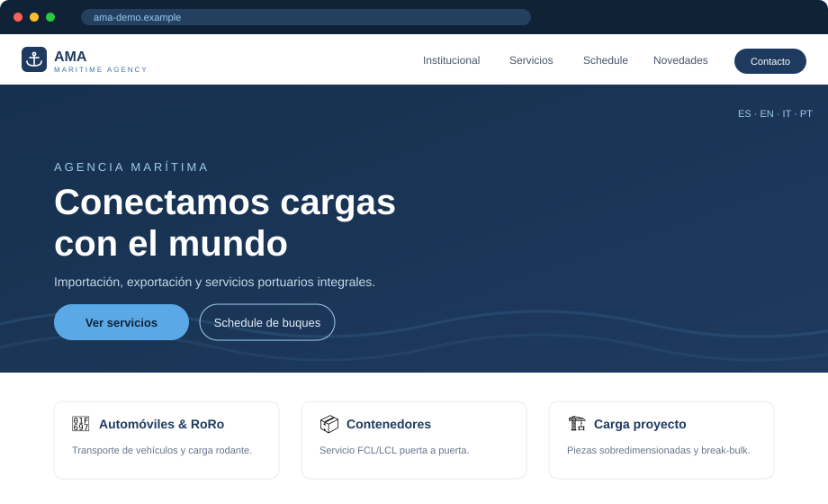
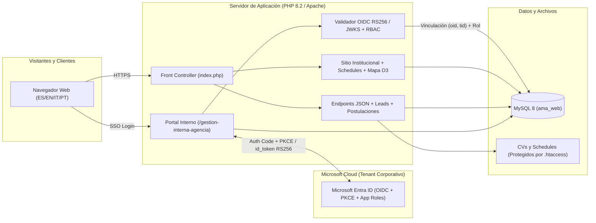
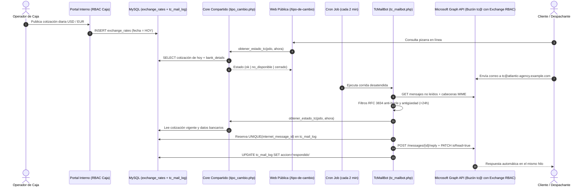

# Maritime Agency Web Platform — v2.0

[](https://github.com/toomastorres/maritime-agency-web/actions/workflows/ci.yml)


> **Nota de confidencialidad (Edición de Portafolio):** Este repositorio contiene la versión **v2.0** anonimizada de un sistema real en producción desarrollado para la filial local de una agencia marítima internacional en Argentina. Toda marca comercial, razón social (*Atlantic Maritime Agency S.A.*), dominio (`atlantic-agency.example.com`), dirección postal, CUIT, teléfono, topología de hosting/ISP y credencial fueron reemplazados por equivalentes ficticios preservando intacta la arquitectura e ingeniería del código productivo.

Plataforma integral que unifica el **sitio institucional multilingüe** (`ES` · `EN` · `IT` · `PT`), las **herramientas operativas de comercio exterior** (pizarra diaria de tipo de cambio, programación de buques y cotizaciones), el **portal interno de autogestión por áreas** federado con **Microsoft Entra ID (OIDC + PKCE + App Roles)** y el **bot desatendido de correo (`TcMailBot`)** integrado con **Microsoft Graph API** bajo permisos acotados a un único buzón compartido en Exchange Online.



---

## Novedades de Ingeniería en v2.0

### 1. Bot Automatizado de Tipo de Cambio (`TcMailBot` + Microsoft Graph + Exchange RBAC)

En la operatoria portuaria diaria, importadores, despachantes de aduana y agentes de carga consultan por correo electrónico a toda hora la cotización operativa de cierre (`USD` / `EUR`) y las cuentas recaudadoras para emitir transferencias locales.

- **Fuente única de verdad (`src/core/tipo_cambio.php`):** Tanto la página pública `/tipo-de-cambio` como el bot de correo consumen exactamente la misma función de dominio (`obtener_estado_tc()`). Aplica de forma determinística la ventana operativa (`Lunes a Viernes, 09:00 a 17:00 ART`), exige cotización con fecha estricta del día en curso y resuelve cuatro estados explícitos: `ok`, `no_disponible`, `cerrado` y `error`.
- **Integración OAuth 2.0 App-Only con Microsoft Graph (`src/core/graph_mail.php`):** Cliente HTTP sin dependencias pesadas que obtiene tokens `client_credentials`, lista mensajes no leídos con sus cabeceras MIME (`internetMessageHeaders`), responde en el mismo hilo (`POST /users/{mailbox}/messages/{id}/reply`) y marca como leído únicamente cuando corresponde.
- **Principio de mínimo privilegio real en Exchange Online:** Aunque Microsoft Graph define `Mail.ReadWrite` y `Mail.Send` como permisos de aplicación a nivel tenant, la arquitectura se despliega acotada con **RBAC for Applications de Exchange Online** (`New-ManagementScope` + `New-ServicePrincipal` + `New-ManagementRoleAssignment`), garantizando criptográfica y administrativamente que la credencial del bot **solo pueda acceder al buzón compartido `tc@`** y reciba `403 ErrorAccessDenied` ante cualquier otra casilla de la organización.
- **Ingeniería anti-bucle, idempotencia y tolerancia a fallos (`src/core/tc_mailbot.php`):**
  - Cumplimiento estricto de **RFC 3834**: descarta rebotes (`Return-Path: <>`), listas de distribución (`List-Id`, `List-Unsubscribe`, `Precedence: bulk|list|junk`), respuestas automáticas (`Auto-Submitted != no`, `X-Auto-Response-Suppress`), cabeceras propias (`X-AMA-Autoreply: tc`), remitentes de sistema (`mailer-daemon`, `postmaster`, `no-reply`, `bounces`) y backlog mayor a 24 h.
  - **Reserva atómica previa al envío:** inserta `UNIQUE KEY (internet_message_id)` en `tc_mail_log` en estado `en_proceso` *antes* de invocar `/reply`. Si dos ejecuciones de cron se solapan o una corrida se interrumpe tras enviar, el mensaje jamás se responde dos veces.
  - **Silencio seguro ante caída de base de datos:** si MySQL no responde dentro del horario hábil, el bot **no contesta información falsa ni marca el correo como leído**; lo deja intacto en el buzón para procesarlo automáticamente en la siguiente corrida cuando el servicio se recupere. Soporta además modo de observación `TC_BOT_DRY_RUN=true`.

### 2. Federación de Identidad Corporativa (`Microsoft Entra ID` OIDC + App Roles RBAC)

El backoffice (`/gestion-interna-agencia`) migró de contraseñas locales a **Single Sign-On corporativo sin contraseñas en la aplicación**:

- **Authorization Code Flow + PKCE (`S256`):** Implementación nativa en PHP (`src/core/entra_oidc.php`) con generación criptográfica de `state`, `nonce` y `code_verifier`, TTL estricto de 10 minutos y consumo de un solo uso (*single-use transaction*) para mitigar CSRF y ataques de *replay*.
- **Validación criptográfica `RS256` contra JWKS:** Verificación directa con OpenSSL de la firma del `id_token` contra las claves públicas de Microsoft (`discovery/v2.0/keys`), soportando tanto cadenas X.509 (`x5c`) como reconstrucción ASN.1/DER de claves públicas RSA desde módulo y exponente `(n, e)`, con caché local y refresco automático ante rotación de `kid`.
- **Mitigación de `nOAuth` y aislamiento de tenant:** Validación estricta de `iss`, `tid`, `aud`, `exp`, `nbf` y `nonce`. La cuenta local se vincula de forma inmutable por la dupla **`(entra_oid, entra_tid)`** — nunca se autoriza por el claim mutable `email`.
- **Seguridad de sesión compatible con redirecciones OIDC:** Cookie `__Host-AMA_PORTAL` con `Secure`, `HttpOnly`, `use_strict_mode=1`, `SameSite=Lax` (indispensable para recibir el callback cross-site desde `login.microsoftonline.com` sin degradar la protección CSRF), huella de `User-Agent` y expiración por inactividad.
- **Autorización por App Roles (`src/core/entra_roles.php`) y Diseño Dual de App Registrations:**
  - Mapeo *fail-closed* de roles emitidos en el token (`Portal.Caja`, `Portal.CS`, `Portal.RRHH`, `Portal.Documentacion`, `Portal.AdminGlobal`). Si un usuario autenticado carece de rol asignado en Entra ID, el acceso se rechaza y audita.
  - **Cuenta Break-Glass de emergencia:** con Entra activo, la interfaz oculta por completo los formularios de contraseña a los empleados; solo una cuenta de emergencia explícitamente marcada (`is_break_glass = 1`) puede autenticarse localmente mediante `?emergencia=1`, quedando cada ingreso registrado en `admin_audit_logs`.
  - **Separación de Acceso Condicional / Intune (`docs/PORTAL_ENTRA_ID.md`):** arquitectura de dos *App Registrations* (`Portal Interno` para operadores y `Portal Interno — Administradores`) para exigir MFA phishing-resistant y dispositivo administrado por Intune a cuentas privilegiadas sin friccionar la operación diaria.

### 3. Plataforma Web, UX *Oltremare* y Operaciones Portuarias

- **Sistema de diseño *Oltremare*:** identidad visual marítima coherente en CSS modular (`variables.css`, `layout.css`, `components.css`), cabecera con transición *glassmorphism*, selector de idioma en tiempo real (`src/i18n/{es,en,it,pt}.json`) y *cache-busting* automático por hash MD5 de contenido (`assetUrl()`).
- **Mapa interactivo de red marítima (`mapa-red`):** visualización vectorial con **D3.js + TopoJSON** de las rutas transatlánticas entre el Norte de Europa, Mediterráneo, África Occidental y Costa Este de Sudamérica, con soporte completo de internacionalización.
- **Motor de Schedules de Buques:** ingesta desde planillas Excel (`.xls` / `.xlsx`) mediante `SimpleXLS` / `SimpleXLSX`, persistencia columnar estructurada (`schedule_imports` + `schedule_port_calls`), invalidación automática de caché al publicar una nueva semana, indicador visual de vigencia y exportación a PDF institucional.
- **Directorio Operativo por Área y Portal RRHH:** directorio público centralizado por departamento (`src/logic/contactos_model.php`) con discado automático de internos mediante pausas DTMF en móviles (`tel:+541140000000,113`), recepción de CVs con validación real de MIME (`finfo`) y contador de postulaciones pendientes en el sidebar administrativo.
- **Arquitectura híbrida de correo saliente (`docs/EMAIL_SETUP.md`):** convivencia limpia entre el correo corporativo en Microsoft 365 y las notificaciones transaccionales del servidor web mediante alineación SPF + firma DKIM dedicada y enrutamiento segmentado por área (`NOTIFY_CAJA`, `NOTIFY_CS`, `NOTIFY_DOCS`, `NOTIFY_RRHH`, Comercial).

---

## Arquitectura del Sistema

### Vista General: Web Pública, SSO con Microsoft Entra ID y Persistencia



### Flujo End-to-End: Tipo de Cambio Operativo y `TcMailBot`



---

## Estructura del Repositorio

```text
├── api-bridge/                        # Bridge HTTP de solo lectura autenticado por Bearer token
├── database/
│   ├── install.sql                    # Esquema unificado MySQL 8 + migración idempotente (__ama_migrate)
│   ├── migrations/                    # Migraciones incrementales documentadas (Entra ID, TcMailBot)
│   ├── seed_demo.sql                  # Datos ficticios para demo local con Docker Compose
│   └── reset_data.sql                 # Script manual opcional de limpieza de tablas
├── docs/                              # Documentación técnica de arquitectura, seguridad y operación
│   ├── ARCHITECTURE.md                # Capas, ruteo y modelo de datos
│   ├── ENTRA_ID_SETUP.md              # Configuración paso a paso de OIDC, App Roles y JWKS
│   ├── PORTAL_ENTRA_ID.md             # Arquitectura dual de App Registrations + Acceso Condicional / Intune
│   ├── TIPO_CAMBIO_MAILBOT.md         # Diseño del bot Graph + Exchange Online Application RBAC
│   ├── EMAIL_SETUP.md                 # Convivencia DNS/SPF/DKIM entre Microsoft 365 y servidor web
│   └── SECURITY.md                    # Controles OWASP, CSP, sesiones, CSRF y rate limiting
├── private/gestion-interna-agencia/   # Backoffice modular por roles (Caja, CS, RRHH, Novedades, Auditoría)
│   ├── auth/                          # Endpoints OIDC (login.php, callback.php)
│   ├── includes/                      # Sesión segura, CSRF, política NIST 800-63B y helpers
│   └── views/                         # Vistas administrativas desacopladas por permiso
├── public/assets/                     # CSS Oltremare, JS modular (D3 mapa-red, i18n, schedules) e íconos SVG
├── src/
│   ├── components/                    # Header, footer y parciales reutilizables
│   ├── config/                        # Configuración central, zona horaria ART y assetUrl()
│   ├── core/                          # Núcleo: entra_oidc, entra_roles, tc_mailbot, graph_mail, tipo_cambio, email
│   ├── i18n/                          # Diccionarios completos ES / EN / IT / PT
│   ├── logic/                         # Endpoints de API pública y modelos de dominio
│   └── pages/                         # Vistas públicas servidas por el front controller
└── tests/                             # Suite automatizada de pruebas unitarias y de integración (sin red)
```

---

## Suite de Pruebas Automatizadas

El proyecto cuenta con **5 suites automatizadas (131 aserciones en total)** que validan la criptografía OIDC, reglas de autorización, controles anti-bucle del bot de correo y renderizado seguro de vistas usando dobles en memoria y SQLite (`pdo_sqlite`), sin requerir conexión a Internet ni credenciales reales:

| Suite | Archivo | Cobertura principal |
|---|---|---|
| **TcMailBot & Core TC** | `tests/test_tc_mailbot.php` | Regla horaria `09:00–17:00`, filtros RFC 3834 anti-bucle, palabras de borde (`abuse`), clave de idempotencia, escapado XSS, estados `ok` / `no_disponible` / `cerrado` / `error`. |
| **Entra ID OIDC & JWKS** | `tests/test_entra_oidc.php` | Firma `RS256` real (`x5c` y reconstrucción `n`/`e`), rechazo de `alg: none`, firma alterada, `tid` ajeno, `aud` inválido, `nonce` incorrecto, expiración con *clock skew* y rotación de `kid`. |
| **App Roles RBAC** | `tests/test_entra_roles.php` | Mapeo exacto de `Portal.*`, política *fail-closed*, precedencia con múltiples roles y whitelist anti *open-redirect* en `return_to`. |
| **Transacciones OIDC** | `tests/test_entra_state.php` | Integridad de `state`, consumo *single-use* ante intentos de manipulación o *replay* y expiración estricta (>600 s). |
| **Seguridad de UI Portal** | `tests/test_entra_ui.php` | Ausencia total de inputs `password` para empleados con Entra activo, aislamiento de `?emergencia=1`, escapado XSS y alineación de tablas pre/post migración. |

### Ejecutar las pruebas localmente

Con PHP 8.2+ instalado:

```bash
composer test
```

O directamente con Docker (sin instalar PHP en el host):

```bash
docker run --rm -v "$(pwd):/app" -w /app php:8.2-cli bash -c "
  php tests/test_tc_mailbot.php &&
  php tests/test_entra_oidc.php &&
  php tests/test_entra_roles.php &&
  php tests/test_entra_state.php &&
  php tests/test_entra_ui.php
"
```

El workflow de integración continua (`.github/workflows/ci.yml`) ejecuta en cada *push* y *pull request* el chequeo sintáctico de los 70 archivos PHP (`php -l`), la validación de `composer.json` y de los diccionarios `src/i18n/*.json`, y las 5 suites completas.

---

## Levantar la Demo Completa con Docker Compose

El repositorio incluye un entorno listo para ejecutar con **Apache + PHP 8.2 + MySQL 8** que inicializa automáticamente el esquema unificado (`database/install.sql`) y un conjunto de datos ficticios (`database/seed_demo.sql`: cotizaciones `USD`/`EUR` del día, datos bancarios de ejemplo, itinerarios de buques, novedades y vacantes):

```bash
git clone https://github.com/toomastorres/maritime-agency-web.git
cd maritime-agency-web
docker compose up --build
```

Una vez saludable el contenedor de MySQL:

- **Sitio público:** [http://localhost:8080](http://localhost:8080)
  - Pizarra de Tipo de Cambio: [http://localhost:8080/tipo-de-cambio](http://localhost:8080/tipo-de-cambio)
  - Schedules de Buques: [http://localhost:8080/schedule](http://localhost:8080/schedule)
  - Mapa Interactivo de Red: [http://localhost:8080/mapa-red](http://localhost:8080/mapa-red)
- **Portal de Gestión Interna:** [http://localhost:8080/gestion-interna-agencia/](http://localhost:8080/gestion-interna-agencia/)
  - *Credenciales locales del entorno demo (sin Entra ID configurado):*
    - **Usuario:** `admin_demo`
    - **Contraseña:** `DemoPuertoAtlantico2026!`

Para apagar y limpiar los volúmenes de prueba:

```bash
docker compose down -v
```

---

## Licencia

Distribuido bajo la licencia [MIT](LICENSE). Desarrollado por **Tomás Torres**.
